# BAYBREAK.exe

**Skate the hills. Surf the bay. Break into tech.**

A five-level pixel-art San Francisco adventure dressed up as a lost Windows 98 game. Bomb a Victorian hill, jump a moving commuter train, surf the bay, fly a white rocket-powered roadster over the Bay Bridge at sunset, and skate down California Street collecting résumés for one last job application.

It runs entirely in the browser. No install, no build step, no account.

### [▶ Play it now](https://barneysmith-sys.github.io/baybreak/)


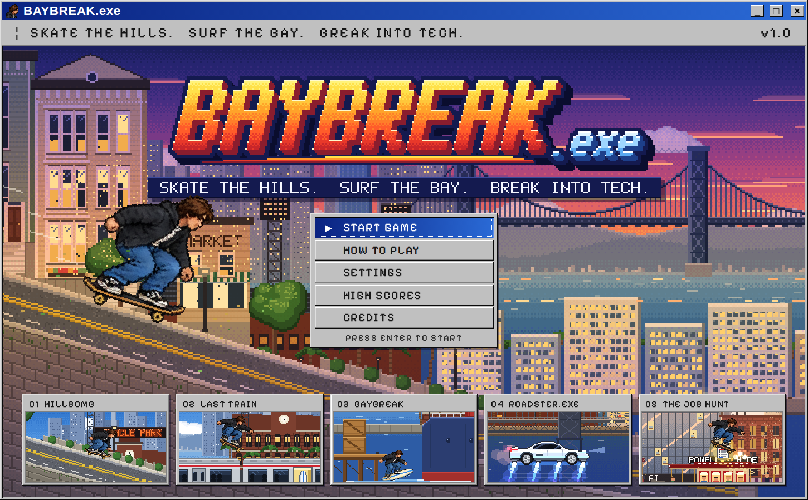

---

## The five levels

| | Level | What happens |
|---|---|---|
| 01 | **HILLBOMB** | Push off at the top of Potrero Hill and let gravity take over. Ollie the cones, collect coins, then launch off the ledge onto a moving train. |
| 02 | **LAST TRAIN** | Ride the roof past Oracle Park and Mission Bay. Duck the low signals, grab the surfboard from the glowing doorway, and launch off the nose when the line runs out. |
| 03 | **BAYBREAK** | Swap to the surfboard midair. Ride the waves, jump buoys, climb the docks and a container ship, and find a white roadster waiting on a cargo deck. |
| 04 | **ROADSTER.EXE** | Sunset over the bay. Four underbody rocket thrusters ignite one by one and lift the white roadster off the cargo ship. Thread the Bay Bridge tower portals, dodge delivery drones and gulls, boost past the waterfront, and weave through the skyline to land downtown. |
| 05 | **THE JOB HUNT** | Back on the board, bombing down a steep California Street toward the Bay Bridge and the Ferry Building at sunset. Dodge traffic, ride the red-and-cream cable car, collect five résumés, then apply at OpenArc HQ. |

Then: **APPLICATION SUBMITTED. STATUS: UNDER REVIEW.** And then, inevitably, an email.

| | |
|---|---|
| 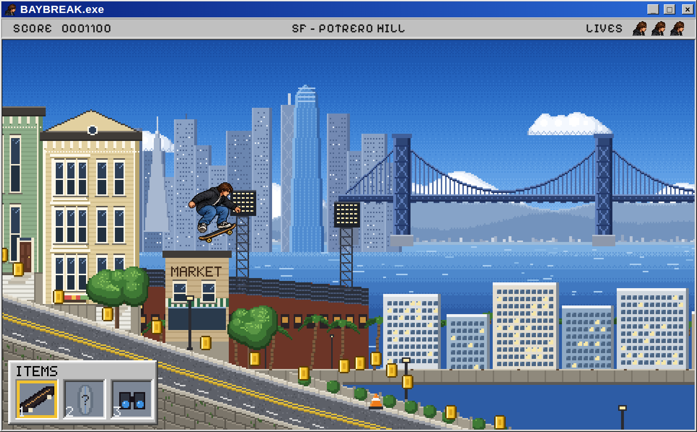 | 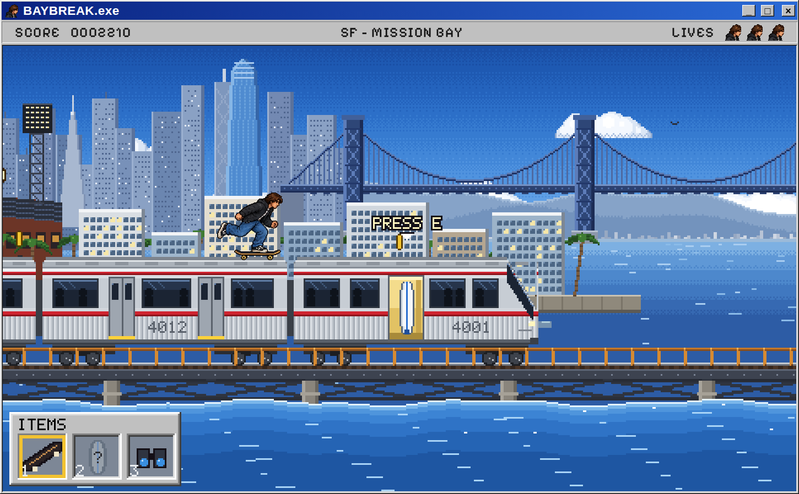 |
| 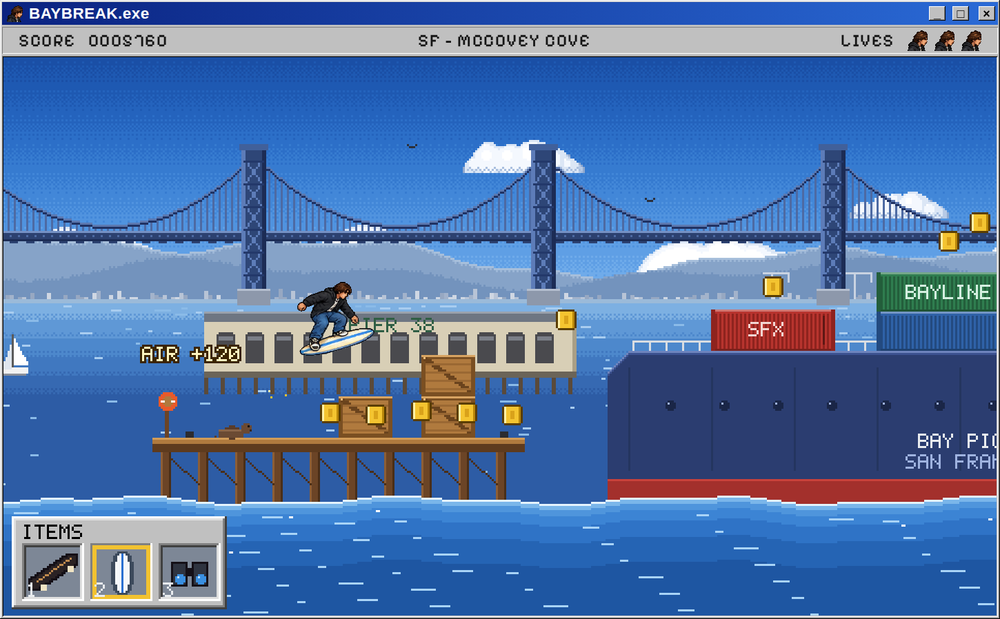 | 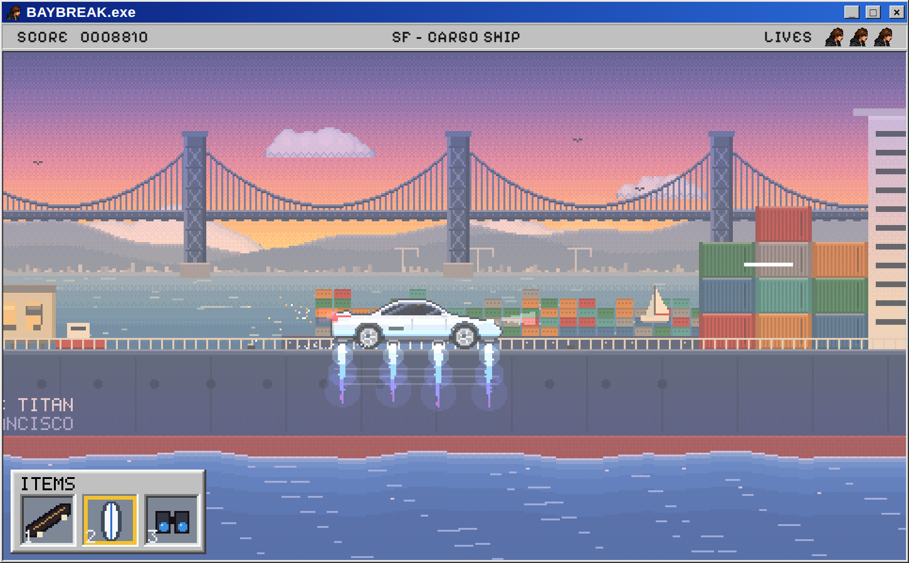 |
| 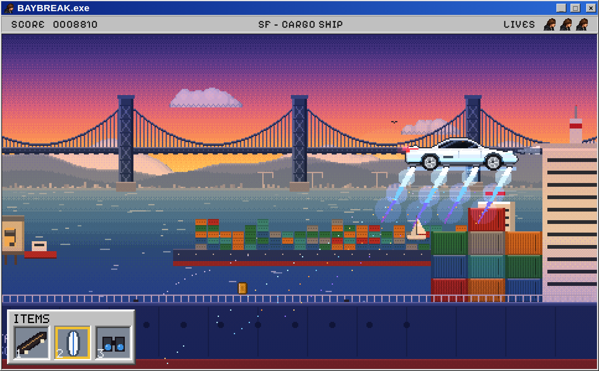 | 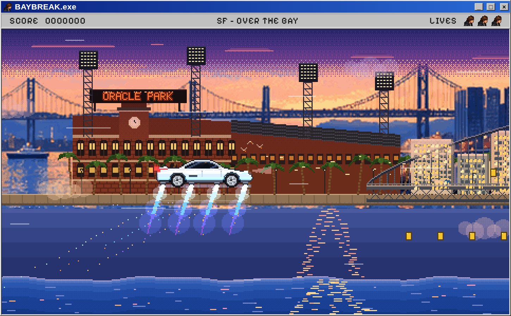 |
| 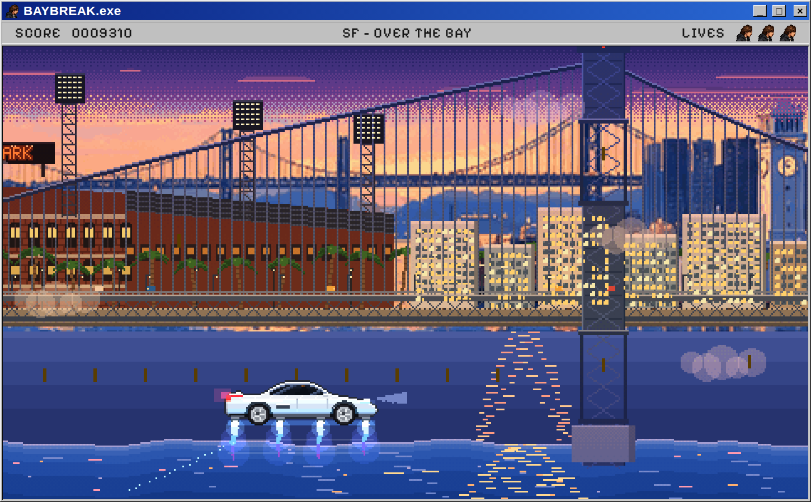 | 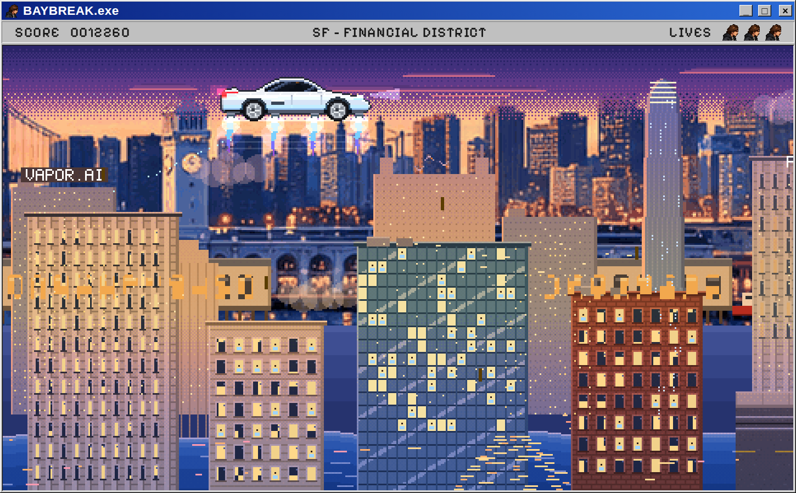 |
| 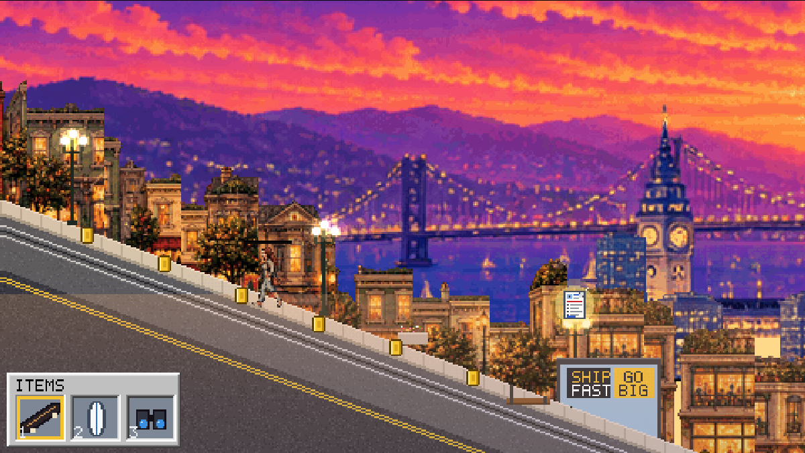 | 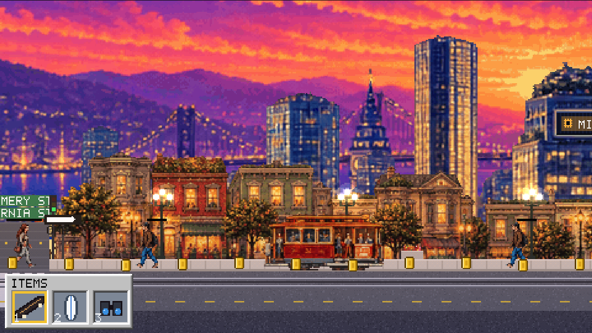 |
| 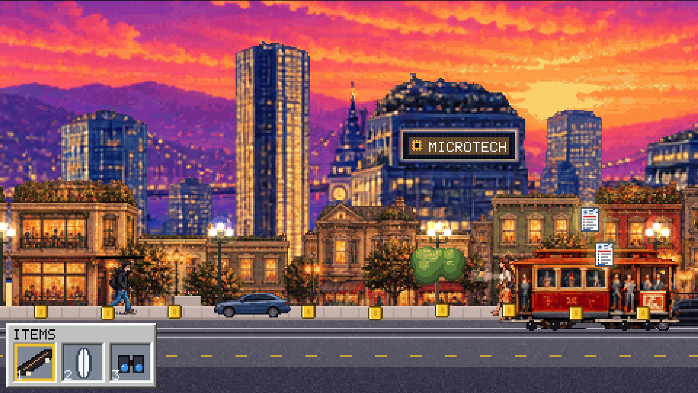 | 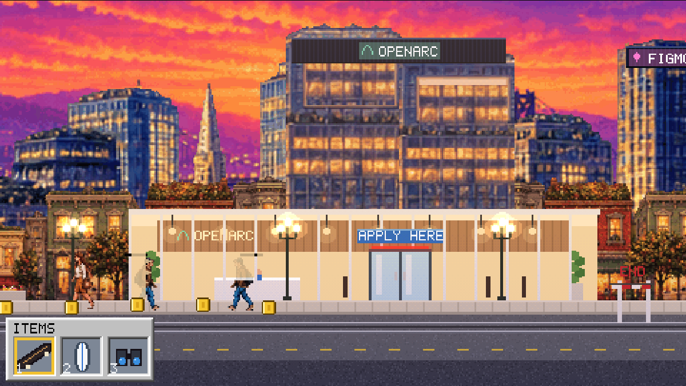 |
| 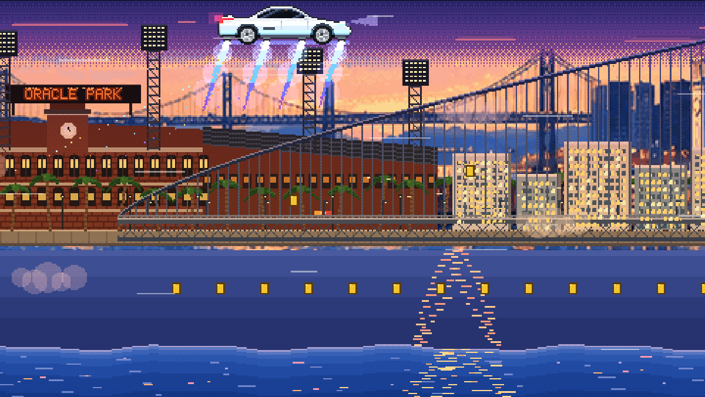 | 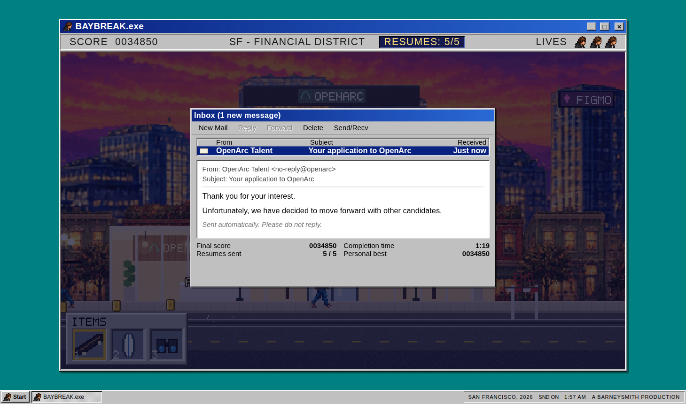 |

---

## Controls

**On the board** (levels 1, 2, 3 and 5)

| Key | Action |
|---|---|
| `D` or `→` | Push. Gravity does the rest downhill |
| `A` or `←` | Slow down, then roll back |
| `Space` | Ollie |
| `S` or `↓` | Crouch. Hold it, then jump, for a big ollie |
| `Shift` | Brake |
| `E` | Interact: grab the surfboard, equip it, enter the roadster, apply |
| `1` `2` | Skateboard or surfboard |
| `B` | Binoculars to look ahead |

**In the roadster** (level 4)

| Key | Action |
|---|---|
| `W` / `↑` | Climb |
| `S` / `↓` | Dive |
| `D` / `→` | Boost: full rocket thrust |
| `A` / `←` | Ease off |

**Anywhere**

| Key | Action |
|---|---|
| `Esc` | Pause menu |
| `R` | Back to the last checkpoint |
| `M` | Mute |
| `Enter` | Start from the title screen |

Touch buttons appear on phones and tablets. The game is built for a keyboard, and phones play best in landscape.

## How to play

- **Three lives.** Each level has checkpoints, so a wipeout sends you back a few seconds, not to the start.
- **Big ollies matter.** Hold `S`, then press `Space`, to clear tall walls and reach high pickups.
- **The surfboard swap is the trick.** When you leave the train, time slows. Press `E` before you hit the water.
- **Ride vehicles, don't fight them.** You can land on cable car and taxi roofs. Reach a roof edge mid-jump and you'll pull yourself up. Clear a whole cable car in one jump for a bonus.
- **Résumés first.** The OpenArc door stays locked until you've collected all five.
- **Jump to any level.** The level cards on the title screen start you at that level.

Your personal best and top five runs are saved on your device.

---

## Run it locally

Download the repository and open `index.html` in Chrome, Edge, Firefox or Safari. That's it.

Everything the game needs, including its fonts, is inside this folder, so it also works offline.

## Project structure

```
index.html          The whole game: HTML, CSS and JavaScript in one file
assets/fonts/       Pixelify Sans, self-hosted (SIL Open Font License)
assets/icons/       Favicons
assets/social/      Link preview image for LinkedIn and other sites
assets/art/         Illustrated PNG layers and sprites (Level 04 bay panorama; Level 05 sky, downtown, street front, cable car, cars, pedestrians)
assets/rider/       Source sprite strips and metadata for the rider
docs/               README screenshots and the art spec
```

Levels 01 to 04 draw most of their world in code when the game loads. Level 05 is built from illustrated PNG layers in `assets/art/`, with real parallax: sunset and bay, downtown towers, then the street front. and the rider's approved animation frames are embedded in `index.html`. The bay panorama in `assets/art/` is a real PNG layer, built from the approved concept sheet and processed onto the game's pixel grid. More PNG layers can replace the code-drawn ones without touching gameplay. See [docs/ART-SPEC.md](docs/ART-SPEC.md). The PNG strips in `assets/rider/` are reference copies of the rider frames.

## Deployment

This is a static site. GitHub Pages serves `index.html` straight from the `main` branch, with no build step or workflow.

Every asset path is relative, so the game works at `https://barneysmith-sys.github.io/baybreak/`.

---

## Credits

- **Created by:** [Barney J. Smith](https://barneyjsmith.com/)
- **Built with:** Claude by Anthropic
- **Level 05 and Level 04 illustrated art:** Barney J. Smith's approved concept art and asset sheet, processed onto the game's pixel grid
- **Rider animations:** the approved Claude Design character sheet (51 frames, 10 animations)
- **Font:** [Pixelify Sans](https://github.com/eifetx/Pixelify-Sans) by Stefie Justprince, SIL Open Font License 1.1 (`assets/fonts/OFL.txt`)
- **Sound:** synthesized live in the browser with the Web Audio API, with no audio files

## Licensing and notes

- **Game code and art:** © 2026 Barney J. Smith. All rights reserved.
- **Font:** Pixelify Sans keeps its own open license.
- **Settings:** Real San Francisco places appear as settings. This is a fan-made game with no affiliation to any team, transit agency, carmaker or company.
- **Original designs:** the roadster, the train and the cable cars are original designs. OpenArc, and every company on every sign in the Financial District, is fictional. Edit names, colours and sign placement in one place: `BRANDS` and `L5_SIGN_LAYOUT` in `index.html`.
